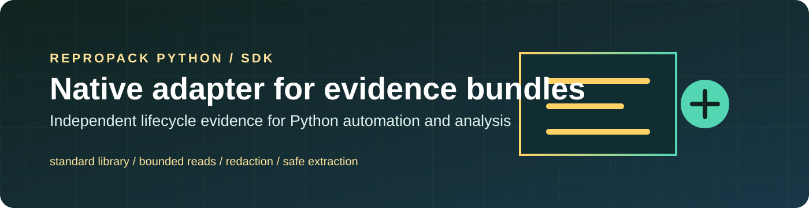

# ReproPack for Python

<p align="center"></p>

<p align="center">
  <a href="https://github.com/ReproPack/repropack-python/actions/workflows/ci.yml"></a>
  <a href="https://img.shields.io/badge/runtime-Python%203.11%2B-2f6f9f"></a>
  <a href="LICENSE"></a>
  <a href="https://pypi.org/project/repropack/"></a>
  <a href="https://img.shields.io/badge/status-v0.1.1%20released-2ea44f"></a>
</p>

ReproPack for Python is a native standard-library implementation for validating manifests, creating and reading stored-ZIP evidence bundles, verifying integrity, applying explicit redactions, and extracting safely.

## Repository role

This repository is the Python implementation and adapter. It owns the Python package, models, archive operations, integrity checks, redaction helpers, safe extraction, and implementation-level tests. The canonical format remains in [repropack-core](https://github.com/ReproPack/repropack-core).

## Architecture

<p align="center"></p>

## What you get

- typed Python models for manifests, evidence, limits, and errors;
- canonical JSON and SHA-256 integrity checks;
- bounded archive reads and safe extraction;
- explicit redaction helpers with advisory warnings;
- shared semantic fixtures used by the ReproPack ecosystem.

The SDK consumes the Core specification and shared fixtures independently. Conformance evidence covers the current contract; it does not certify future integrations or arbitrary external consumers.

## Quickstart

Create an isolated environment and install the project locally:

```bash
python -m venv .venv
# macOS/Linux
source .venv/bin/activate
# Windows PowerShell: .venv\Scripts\Activate.ps1
python -m pip install --upgrade pip
python -m pip install .
python -m unittest discover -s tests -v
```

For a CI failure-capture workflow, use the Core [integration example](https://github.com/ReproPack/repropack-core/blob/main/docs/CI_INTEGRATION.md) and adapt only explicitly selected evidence files.

The SDK is exported from the `repropack` package. Build distribution artifacts with:

```bash
python -m build
```

For the format walkthrough, see the Core [tutorial](https://github.com/ReproPack/repropack-core/blob/main/docs/TUTORIAL.md).

## Documentation and status

| Need | Start here |
| --- | --- |
| Understand the format | [Core specification](https://github.com/ReproPack/repropack-core/blob/main/docs/SPECIFICATION.md) |
| See Python API behavior | [Specification mapping](docs/SPECIFICATION_MAPPING.md) |
| Understand implementation boundaries | [Architecture](docs/ARCHITECTURE.md) |
| Run tests and contribute | [Development guide](docs/DEVELOPMENT.md) |
| Review compatibility | [Conformance guide](docs/CONFORMANCE.md) |
| Follow project progress | [Roadmap](ROADMAP.md) |

## Status

v0.1.1 is released on GitHub and `repropack==0.1.1` is publicly available on PyPI. Future integrations remain outside the current package contract.

## Related repositories

| Repository | Role | Link |
| --- | --- | --- |
| **repropack-core** | Specification, schema, fixtures, Rust reference model, and CLI | [Core](https://github.com/ReproPack/repropack-core) |
| **repropack-typescript** | Native Node.js SDK and adapter | [TypeScript](https://github.com/ReproPack/repropack-typescript) |
| **repropack-python** | Native Python SDK and adapter | This repository |

## Project links

[License](LICENSE) · [Contributing](CONTRIBUTING.md) · [Security](SECURITY.md) · [Code of Conduct](CODE_OF_CONDUCT.md) · [Changelog](CHANGELOG.md) · [Support](SUPPORT.md)
